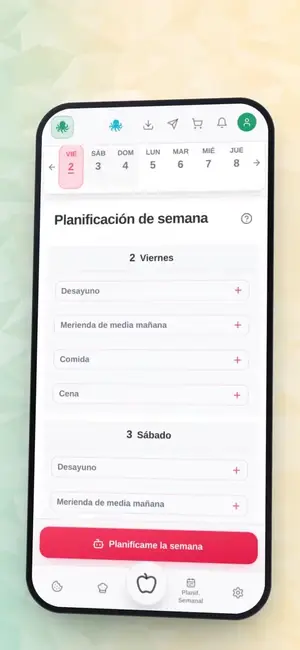
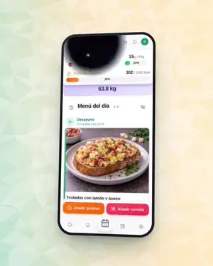
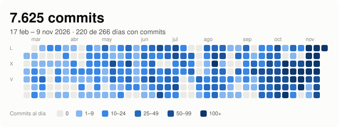

# Bibofit

**Dieta flexible con un asistente de IA que explica cada recomendación.**

App web instalable (PWA), en producción en **[bibofit.com](https://bibofit.com)**. 
Diseñada, programada y operada por una persona: [Jesús Martínez](https://github.com/JesusMartinezCamps).

> El código es privado porque Bibofit es un producto en producción, con pagos reales.
> Este repositorio enseña qué hace, cómo está construido y el trabajo que lleva.

## Así funciona

<table>
<tr>
<td align="center" width="50%"> <b>Bibo</b>: le cuentas qué has comido y lo cuadra con tu plan</td>
<td align="center" width="50%"> <b>Planificar</b>: rellena la semana con recetas de tu plan, sin las que choquen con tus restricciones</td>
</tr>
<tr>
<td align="center"> <b>Recetas</b>: cambias raciones y los macros se recalculan al momento</td>
<td align="center"> <b>Picoteos</b>: salirse del plan también cuenta, y luego se ajusta</td>
</tr>
</table>

## El trabajo

<picture>
  <source media="(prefers-color-scheme: dark)" srcset="assets/actividad-oscuro.svg">
  
</picture>

| | |
|---|---|
| Commits | 7.625 en 9 meses (el récord, octubre: 2.765) |
| Migraciones SQL | 626 |
| Edge Functions | 43 |
| Tests | ~4.700 casos de front + 390 tests SQL de base de datos |

## Stack

| Capa | Tecnología |
|---|---|
| Front | React 18, Vite 7, Tailwind, Radix UI, TanStack Query 5, React Hook Form + Zod, three.js |
| Backend | Supabase: Postgres 17 con Row Level Security, Auth y Edge Functions en Deno 2 |
| IA | Google Gemini: chat, embeddings y RAG, generación de imágenes y voz |
| Pagos | Stripe Checkout, Customer Portal y webhooks |
| Infra | Hostinger (front) y Supabase Cloud en París |
| Calidad | Vitest + Testing Library, tests SQL de permisos, Playwright |

## Por dentro

- **Local-first.** La pantalla pinta desde una caché guardada en el móvil, sin esperar a la red. Cada gesto es un comando que se guarda y sale por una única cola: sin conexión no se pierde nada, y el servidor lo aplica una sola vez.
- **Un cálculo, dos sitios.** Las reglas de la dieta son funciones puras en TypeScript que usan a la vez el navegador y las Edge Functions: lo que ves al instante es lo mismo que guarda el servidor.
- **La seguridad, en la base.** Row Level Security en cada tabla con datos de usuario, probada con tests SQL que llaman como lo haría el usuario.
- **Una IA que cita y actúa.** Bibo responde con RAG sobre un corpus de evidencia científica versionado en la base, y puede apuntar o mover comidas en tu plan.
- **Despliegue en un solo lote.** Una puerta previa lo prueba todo (migraciones, funciones, front y corpus de la IA); producción se publica entera o no se publica.
- **Vídeos hechos con código.** Los tutoriales de la app los graba un guion de Playwright sobre la app real con datos sintéticos, con narración por voz sintética.

## Cómo trabajo

Una persona con agentes de IA: el 79 % de los commits están co-firmados con Claude Code.
Cada tarea va en su propia rama y carpeta, con tests antes de integrar, y un sistema propio
coordina las sesiones, las copias de seguridad y los despliegues.

El calendario se regenera con `python3 scripts/actividad.py <ruta-al-repo>`: solo lee cuántos commits hay cada día.
